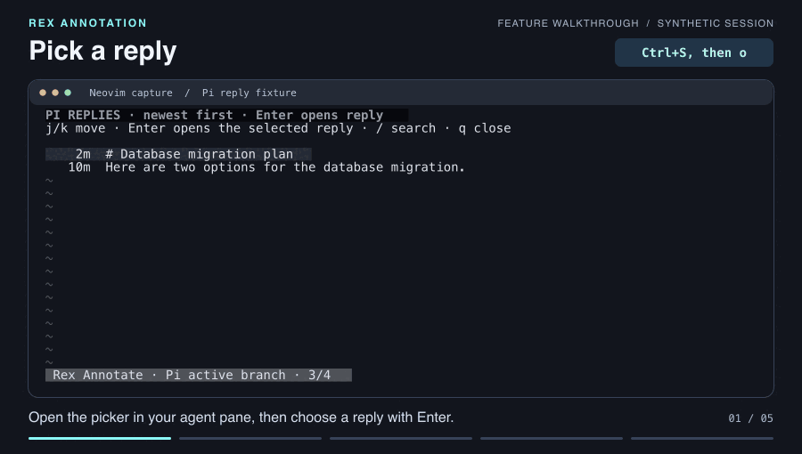

# Rex Annotation

**Quote a coding agent’s reply and give feedback on the exact lines, without leaving Rex.**

Say an agent proposes a migration. Select the line that says “drop the old table,”
add “keep it until the backfill is verified,” and insert the quote and comment
into the original conversation’s draft. You can review the draft before sending.

Rex Annotation is a keyboard-first plugin for [Rex](https://www.superlogical.com/rex)
on **macOS**. It opens a Neovim annotation pane and supports **Pi, Codex CLI,
and Claude Code (including CUX)**. Other terminal panes support copy-only annotation.

[Quick start](#quick-start) · [Usage](docs/usage.md) · [Troubleshooting](docs/setup.md#common-fixes) · [All docs](docs/README.md)



The demo uses a synthetic reply and a simulated draft. No model request is made.

## Quick start

1. Install **Rex with its `rex` CLI**, **Homebrew**, and **one supported agent**.
   See [requirements and supported versions](docs/setup.md#required-tools).
2. Run these commands. Homebrew installs the plugin, Python, and Neovim;
   `rex-annotation install` configures Rex and the supported agents it finds on PATH.

   ```sh
   brew tap arrokh/rex-annotation https://github.com/arrokh/rex-annotation &&
   brew install arrokh/rex-annotation/rex-annotation &&
   rex-annotation install &&
   rex-annotation status
   ```

3. Open Rex and start a new `pi`, `codex`, `claude`, or `cux` process in a pane.
   Once it has a reply, press **Ctrl+S, then o**. Pick a reply with `j` / `k`
   and **Enter**.
4. Press `v` or `V` to select text, then **Enter** to comment. Press **Enter**
   again to save. Use `p` to preview and **Shift+Enter** to insert without
   submitting. **Ctrl+Enter** sends immediately instead.

[Install from source](docs/setup.md#source-checkout) · [Upgrade](docs/homebrew.md#install-or-upgrade) · [Full key reference](docs/usage.md#key-reference)

## Where to go next

| I want to… | Go to |
| --- | --- |
| Check what setup changes or remove it | [Setup and troubleshooting](docs/setup.md) |
| Set up a specific agent | [Agent guides](integrations/README.md#choose-an-agent) |
| Understand what stays local and where feedback goes | [Privacy and limits](docs/usage.md#privacy-and-limits) |
| Compare other review tools | [Related projects](docs/related-tools.md): [Herdr Annotate](https://github.com/plannotator/herdr-annotate), [Plannotator](https://github.com/backnotprop/plannotator), [Plannotator TUI](https://github.com/plannotator/plannotator-tui) |

[Report a bug](https://github.com/arrokh/rex-annotation/issues/new?template=bug_report.md) · [Contribute](docs/CONTRIBUTING.md) · [Security](docs/SECURITY.md) · [Changelog](CHANGELOG.md) · [Releases](https://github.com/arrokh/rex-annotation/releases) · [MIT license](LICENSE)
